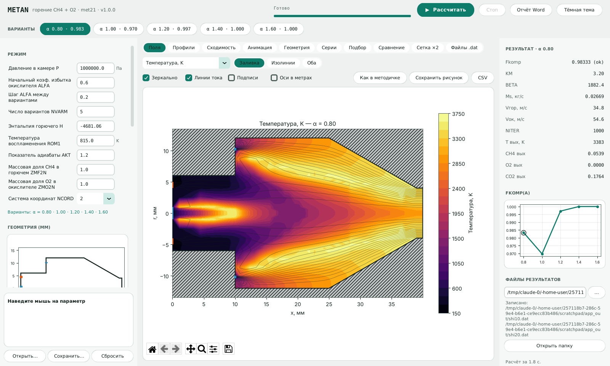
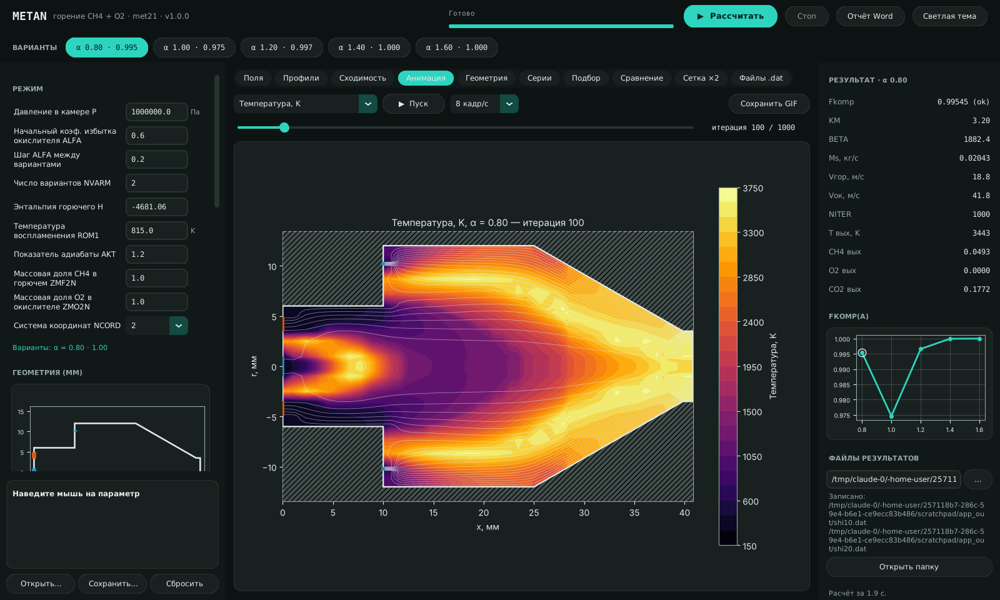
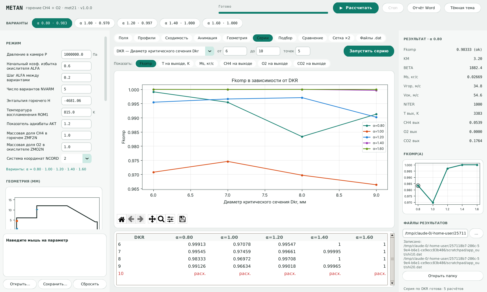

# Metan: расчёт горения метана в камере (Python-версия)

Это перевод на Python программы на Фортране **met21** (файлы `RK1.FOR`–`RK7.FOR`
из папки `нир/met21_ispr`). Программа решает осесимметричную задачу о
течении и горении метана в кислороде в камере с предкамерой и соплом.
Она считает вихрь и функцию тока, закрутку потока, турбулентную вязкость,
концентрации CH4, O2, CO2, H2O, H2, CO, OH, энтальпию, температуру и
плотность. Для каждого коэффициента избытка окислителя ALFA выводится
коэффициент полноты сгорания Fkomp.

## Программы

* **Metan** - новая десктопная программа (оформление «Инженерный пульт»,
  светлая и тёмная тема).
* **Metan-Classic** - прежняя версия интерфейса, сохранена без изменений
  (`python -m metan gui-classic`, `run_gui_classic.bat`, или
  `Metan-Classic.exe`). Её исходное состояние лежит также в ветке
  `classic` репозитория.
* **Командная строка** (`python -m metan`) - аналог исходного `met21.exe`.

Все три после расчёта пишут **те же файлы, что и программа на Фортране**:
`shi10.dat` (протокол) и `shi20.dat` (поля) в том же формате, в папку
результатов (по умолчанию `results` рядом с программой; в новой программе
папка видна справа, кнопка «Открыть папку», содержимое - на вкладке
«Файлы .dat»).




Полное руководство пользователя (Word, с иллюстрациями): 
[docs/Metan_Руководство_пользователя.docx](docs/Metan_Руководство_пользователя.docx) -
открывается также из программы: «Меню → Руководство пользователя».

При запуске показывается пиксельная заставка (пока загружаются библиотеки и
компилируется ядро); сюжет выбирается в «Меню → Заставка при запуске»:
[рассвет на космодроме](docs/splash/dawn.gif), [огневые испытания](docs/splash/teststand.gif),
[чертёж оживает](docs/splash/blueprint.gif) (по данным реального расчёта),
[ночной город](docs/splash/city.gif).
`create_shortcut.bat` создаёт на рабочем столе ярлык со значком-ракетой.

## Возможности новой программы

| Вкладка | Что делает |
|---|---|
| **Поля** | Любая из 16 величин: заливка/изолинии, линии тока, «Как в методичке», сохранение рисунка, CSV |
| **Профили** | T(r) в любом сечении (по умолчанию - на выходе), T(x) вдоль оси, состав (7 компонентов) в сечении; все варианты α на одном графике |
| **Сходимость** | Изменение ψ, T, CH4, ω за каждую итерацию (лог. шкала) и вывод «установился / не установился» |
| **Анимация** | Как поле устанавливается по итерациям (кадр каждые N итераций), воспроизведение, сохранение GIF |
| **Геометрия** | Схема камеры с размерами и расчётной сеткой до запуска, проверка геометрии (ошибки показываются сразу, ещё и на мини-схеме слева) |
| **Серии** | Расчёт при ряде значений любого параметра (Dkr, P, ширина щелей, ...): графики Fkomp, T на выходе, Ms, состава от параметра для всех α; расчёты идут параллельно |
| **Подбор** | Автоматический подбор геометрии (1-11 параметров в заданных границах) на максимум Fkomp при заданном α, кнопка «Применить найденные значения» |
| **Сравнение** | Два любых расчёта/варианта рядом в одной шкале или карта разности B − A; расчёт можно сохранить в файл и сравнить позже |
| **Сетка ×2** | Тот же расчёт на сетке, где каждый интервал разбит на 2 (или 3): насколько результат зависит от сетки |
| **Файлы .dat** | Содержимое shi10.dat и shi20.dat |
| **Отчёт Word** | Кнопка вверху: .docx с исходными данными, таблицами, рисунками с подписями «Рисунок N – …», графиками, серией, подбором и проверкой сетки |



## Командная строка

```bash
python -m metan                                # параметры по умолчанию -> shi10.dat, shi20.dat
python -m metan -o results                     # в папку results
python -m metan -p my.json                     # параметры из файла
python -m metan --set ALFA=0.7 --set NVARM=3   # изменить отдельные параметры
python -m metan --precision float32            # точность как в исходной программе
python -m metan --dump-params my.json          # сохранить параметры для правки
python -m metan gui                            # открыть десктопную программу
python -m metan gui --dark                     # ... сразу в тёмной теме
python -m metan gui-classic                    # прежняя версия интерфейса
```

Пример файла параметров лежит в `examples/params_default.json`. Файлы
параметров одинаковые для командной строки и для окна («Файл → Открыть /
Сохранить»).

## Прежняя программа (Metan-Classic)

* **Слева**: исходные данные, сгруппированные по вкладкам «Режим»,
  «Геометрия», «Сетка», «Расчёт и вывод». При наведении мыши на параметр
  появляется подсказка с его именем в Фортране. Под вкладками видно, при
  каких ALFA будут посчитаны варианты.
* **«Сводка по вариантам»**: ALFA, KM, BETA, расходы, скорости, число
  итераций, Fkomp. Варианты, где расчёт разошёлся, выделены красным.
* **«Поля»**: карта любой величины (температура, функция тока, вихрь,
  концентрации, скорости, плотность и т. д.) с линиями тока и контуром
  камеры. Картинку можно сохранить в PNG/PDF/SVG, а поля варианта
  выгрузить в CSV («Файл → Экспорт»).
* **«Протокол»**: содержимое `shi10.dat`.

Расчёт идёт в фоне, его можно остановить кнопкой «Стоп».

## Параметры

**Режим**

| Имя | Описание | По умолчанию |
|---|---|---|
| `P` | Давление в камере P, Па | 1000000.0 |
| `ALFA` | Начальный коэф. избытка окислителя ALFA | 0.6 |
| `DALFA` | Шаг ALFA между вариантами | 0.2 |
| `NVARM` | Число вариантов NVARM | 5 |
| `H` | Энтальпия горючего H | -4681.06 |
| `ROM1` | Температура воспламенения ROM1, K | 815.0 |
| `AKT` | Показатель адиабаты AKT | 1.2 |
| `ZMF2N` | Массовая доля CH4 в горючем ZMF2N | 1.0 |
| `ZMO2N` | Массовая доля O2 в окислителе ZMO2N | 1.0 |
| `NCORD` | Система координат NCORD | 2 |

**Геометрия (мм)**

| Имя | Описание | По умолчанию |
|---|---|---|
| `DKR` | Диаметр критического сечения Dkr, мм | 8.0 |
| `DCMB` | Диаметр центральной струи Dcmw, мм | 2.0 |
| `DOGOR` | Диаметр подачи горючего DOGOR, мм | 8.0 |
| `DELGOR` | Ширина щели горючего DELGOR, мм | 1.0 |
| `DKAR` | Диаметр предкамеры Dprk, мм | 12.0 |
| `DOOK` | Диаметр подачи окислителя Dook, мм | 20.0 |
| `DELOK` | Ширина щели окислителя DELOK, мм | 0.4 |
| `DKS` | Диаметр камеры сгорания Dks, мм | 24.0 |
| `DELKAR` | Длина предкамеры Lprk, мм | 10.0 |
| `ALKS` | Длина цилиндрической части КС Lks, мм | 15.0 |
| `ALKD` | Длина до критического сечения Lkd, мм | 42.239 |
| `TGY` | Тангенс угла сужения сопла tgY | 0.573 |

**Сетка**

| Имя | Описание | По умолчанию |
|---|---|---|
| `IN` | Число узлов по оси X1 (IN) | 46 |
| `JN` | Число узлов по радиусу X2 (JN) | 22 |
| `JZ` | Узел: граница центральной струи JZ | 4 |
| `JZ1` | Узел: внутр. граница горючего JZ1 | 6 |
| `JA` | Узел: внешн. граница горючего JA | 9 |
| `JA3` | Узел: стенка предкамеры JA3 | 12 |
| `JA1` | Узел: внутр. граница окислителя JA1 | 15 |
| `JA2` | Узел: внешн. граница окислителя JA2 | 18 |
| `JC` | Узел: критическое сечение JC (нач.) | 6 |
| `IC` | Узел: критическое сечение IC (нач.) | 45 |
| `IC1` | Узел: начало сужения IC1 (нач.) | 31 |
| `IC2` | Узел: конец предкамеры IC2 | 10 |

**Расчёт и вывод**

| Имя | Описание | По умолчанию |
|---|---|---|
| `NMAX` | Число итераций на вариант NMAX | 1000 |
| `NPRINT` | Итераций без вихря NPRINT | 200 |
| `precision` | Точность вычислений | float64 |
| `out10` | Файл протокола (unit 7) | shi10.dat |
| `out20` | Файл полей (unit 9) | shi20.dat |

Геометрия задаётся в миллиметрах, как в `DATA` исходной программы. В первом
варианте программа переводит её в метры. Целочисленные параметры сетки —
это номера узлов, по которым проходят границы входов, стенок и
критического сечения. `JC`, `IC`, `IC1` подпрограмма GRID уточняет сама.

## Насколько точно повторяется Фортран

Логика перенесена построчно, с тем же порядком обхода узлов (схема
Гаусса–Зейделя чувствительна к порядку), теми же ветвлениями `GO TO`,
ограничителями и константами. Индексация массивов сохранена с 1:
`A[i, j, k]` в Python соответствует `A(I,J,K)` в Фортране.

Проверка (`tests/`, запуск: `python -m pytest`). Эталоны получены
компиляцией исходных `.FOR` через gfortran:

| Режим Python | Эталон | Результат |
|---|---|---|
| `float64` (по умолчанию) | `gfortran -fdefault-real-8` | `shi10.dat` и `shi20.dat` **совпадают байт в байт** (все 5 вариантов, 25 300 чисел полей) |
| `float32` | `gfortran` (REAL*4, как в оригинале) | `shi10.dat` **совпадает байт в байт**, поля 1-го варианта совпадают в пределах округления печати |

### ⚠ Варианты 2–5 в исходной программе (REAL*4)

В одинарной точности исходная программа выдаёт для вариантов 2–5
`NITER=2203` и `KOEF Fkomp = 0.00000`. Это видно и в вашем `shi10.dat`. Это
не физика, а ошибка округления. Начиная со 2-го варианта размеры уже в
метрах, и в GRID проверка `DKR/2 - X2(J) <= 0` из-за округления REAL*4 не
срабатывает на нужном узле. Критическое сечение сдвигается на один узел
(`JC` 6→7, `IC` 45→44), скорость в сопле превышает 27000 м/с, и
срабатывает аварийный выход (`NITER=NITER+1000` в VELDIS).

В двойной точности та же программа считает все варианты нормально:

| ALFA | 0.80 | 1.00 | 1.20 | 1.40 | 1.60 |
|---|---|---|---|---|---|
| Fkomp, REAL*4 (оригинал) | 0.98333 | 0.00000 ✗ | 0.00000 ✗ | 0.00000 ✗ | 0.00000 ✗ |
| Fkomp, двойная точность | 0.98333 | 0.96972 | 0.99708 | 1.00000 | 1.00000 |

Поэтому по умолчанию Python-версия считает в двойной точности (`float64`).
Режим `float32` оставлен, чтобы при необходимости воспроизвести старые
результаты.

### Что не перенесено (на результат не влияет)

* Вычисление `YYY` (равновесная температура) в VISCOS: она использовалась
  только в закомментированном `PRINT`.
* Таблица ALFA/BETA на метках 91–99 в RK2 (обходится `GO TO 145`), цикл
  3001 в BOUND (обходится `GO TO 3078`), подпрограмма `PRINT` (её вызов
  закомментирован).
* Неиспользуемые переменные из `DATA` (`D`, `CC`, `VINT`, `ROT`, `AFI`, `LN`,
  `LMIN` и др.) и начальные таблицы `X1`, `X2`: GRID пересчитывает их до
  использования.

Величины, которые оригинал считал, но не печатал (`FIbeta`, `FIOP`,
`FIOS`, `DOP`, `ZHP`), доступны в `VariantResult.extra` и в таблице
десктопной программы.

## Соответствие файлов

| Фортран | Python |
|---|---|
| `RK1.FOR`: BLOCK DATA | `metan/params.py` (значения по умолчанию) |
| `RK1.FOR`: INIT | `Solver.init` в `metan/solver.py` |
| `RK2.FOR`: главная программа | `Solver.run`, `Solver._variant` |
| `RK3.FOR`: EQN | `metan/kernels.py: eqn` |
| `RK4.FOR`: VISCOS | `kernels.viscos` |
| `RK5.FOR`: VELDIS, CONVEC, GRID | `kernels.veldis`, `kernels.convec`, `Solver.grid` |
| `RK6.FOR`: SORCE | встроена в `kernels.eqn` |
| `RK7.FOR`: BOUND, PRINT1 | `kernels.bound`, `Solver._print1` |

Исходные тексты на Фортране лежат в `fortran_original/` без изменений. Русские
комментарии в `RK2.FOR` были повреждены ещё в исходном архиве.

Номера переменных в массиве `A`: 1 — вихрь, 2 — функция тока, 3 — CH4,
4 — O2, 5 — CO2, 6 — H2O, 7 — H2, 8 — CO, 9 — OH, 10 — энтальпия,
11 — турбулентная вязкость, 12 — плотность, 13 — температура,
14/15 — компоненты скорости, 16 — закрутка.

## Использование из Python

```python
from metan import Params, Solver

p = Params(ALFA=0.7, NVARM=3)
res = Solver(p).run()
for v in res.variants:
    print(v.values["ALFA"], v.fkomp_kind, v.fkomp)
res.write_files("results")          # shi10.dat, shi20.dat
T = res.variants[0].A[:, :, 13]     # поле температуры (индексы с 1)
```
